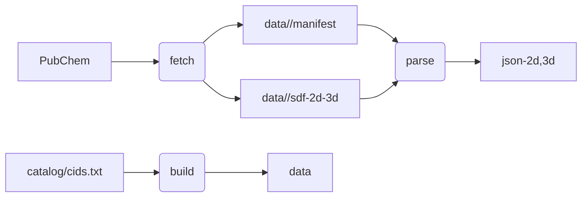

# MolDepot

An ad-hoc repository for chemical compounds, a simplified version of [PubChem](https://pubchem.ncbi.nlm.nih.gov/).  

---  

## 1. Folders

<pre style="white-space: pre; font-family: monospace, SFMono-Regular, Consolas, 'Liberation Mono', Menlo; background-color: #f6f8fa; padding: 16px; border-radius: 6px; overflow-x: auto; line-height: 1.45; font-size: 85%;"><code>MolDepot/
├── catalog/
│   └── cids.txt/               &lt;- id list.
├── data/
│   └── 297/                    &lt;- compound id.
│       ├── manifest.json.      &lt;- Metadata (IUPAC name, Molecular formula)
│       ├── raw.2d.sdf.         &lt;- 2D Geometry + connectivity.
│       ├── raw.3d.sdf          &lt;- 3D Geometry + connectivity.
│       ├── 297.2d.json         &lt;- 2D Json = manifest.json + raw.2d.sdf
│       └── 297.3d.json         &lt;- 3D Json = manifest.json + raw.3d.sdf
├── scripts/
│   ├── fetch.py                &lt;- PubChem.       --&gt; data
│   ├── parse.py                &lt;- sdf + manifest --&gt; json
│   └── build.py                &lt;- catalog/cids   --&gt; data
└── readme.md                   &lt;- this file
</code></pre>  

`data/` is out of Git.

tar.gz for backup.

---
## 2. Diagram
  
  

## 3. Steps

  
1.  **Ingest (`fetch.py`):**

* Parameter = CID (like `297` o `6324`).

* Reads stable endpoints from PubChem

* generates `manifest.json`, `raw.2d.sdf` , and `raw.3d.sdf` if present.

* sends them to `data\<CID>`

*  **Command:**  `python3 scripts/fetch.py <CID>`
  
2.  **Transform (`parse.py`):**

* reads `manifest.json`, `raw.2d.sdf` , `raw.3d.sdf`.

* generates: `<CID>.2d.json` and `<CID>.3d.json` if possible.

*  **Command:**  `python3 scripts/parse.py <CID>`

2.  **Build (`build.py`):**

* for each cid in  `catalog\cids.txt`
* fetch
* parse.

*  **Command:**  `python3 scripts/build.py`

## End

